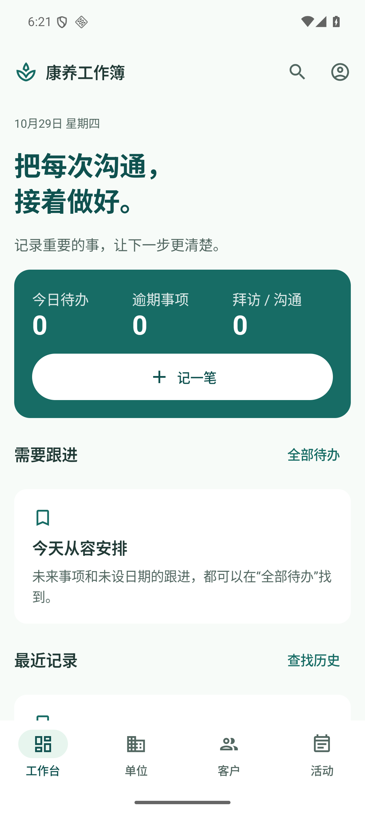

# 康养工作簿

给养老顾问使用的单人离线 Android 工作记录工具。单位拜访、客户沟通、活动安排、后续跟进放在同一个工作簿里，无须注册。

支持独立沟通时间线、多位联系人与服务对象、自动持久草稿、照片与文档附件、非精确本地提醒、全文及日期搜索、CSV/文本导出、口令加密备份和完整恢复。首次安装为空业务数据。



## 使用与验收

- [给朋友的10分钟试用](docs/TRYOUT.md)
- [逐项验收结果、APK身份、已知限制](docs/ACCEPTANCE.md)
- [当前交付状态](STATUS.md)
- [功能说明](docs/PRODUCT.md)、[数据与备份](docs/DATA.md)、[本地提醒](docs/REMINDERS.md)
- [工程环境与绿色来源](docs/TECHNICAL.md)、[数据契约](docs/CONTRACT.md)

支持安装范围为 Android 8.0 及以上；本轮实际验证现有 Android 16 / API 36 模拟器，朋友真实手机尚未测试。当前版本为测试签名试用 APK，覆盖更新须使用同一签名和包名。应用不会自行联网、上传客户资料或调用外部 AI。

## 构建

使用 JDK 17 或更高版本、Android SDK 36。工程已锁定 Gradle 8.13、AGP 8.13.2、Kotlin 2.3.21 等依赖。将 SDK 路径配置在本机 `local.properties`，再运行：

```powershell
.\gradlew.bat :app:assemblePersonalDebug :app:testQaDebugUnitTest :app:lintPersonalDebug
```

输出为 `app/build/outputs/apk/personal/debug/app-personal-debug.apk`。个人包名 `cn.kangyang.workbook`，QA包名 `cn.kangyang.workbook.qa`。重新在其他机器构建会使用该机器的测试签名，不能直接覆盖本次交付签名的已安装版本。

设备验收固定使用本机已有的 `emulator-5554`，执行顺序和命令见验收文档及 `scripts/`。部分测试有明确前置条件，不应把整个 instrumentation 测试目录无差别运行：它包含首次空库、真实进程中断、个人包烟测和不同字号档位。

本地唯一工程根为 `D:\Desktop\Codex\Workbook`。原始日志、完整截图和录屏在 `output/verification`，交付包在 `output/apk`；这些原始材料保留在本机，验收文档中的本地证据链接须在该工作区打开。仓库仅包含源码、测试、文档与精选截图，不包含签名私钥、本机配置、导出的客户资料或完整备份。
