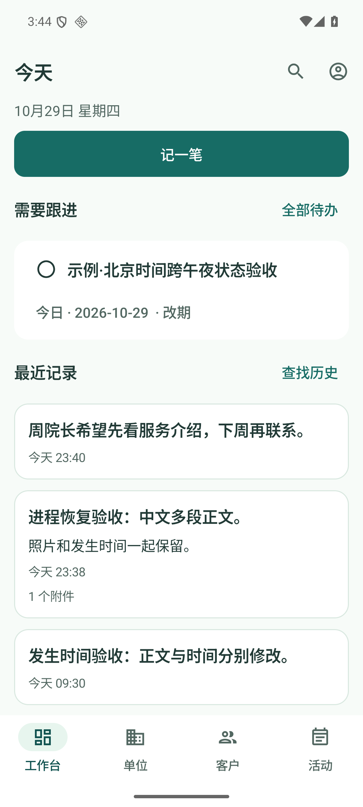
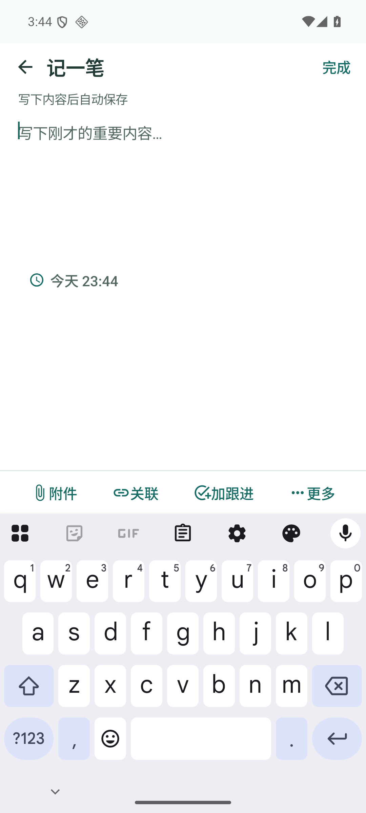

# 康养工作簿

给养老顾问使用的单人离线 Android 工作记录工具。打开工作台，点一次“记一笔”就能写正文；不用先填标题、对象、日期或分类。内容真正保存后，可从最近记录和搜索找回，再补对象、发生时间、附件和跟进。

**V1.1 / 1.1.0 / versionCode 5** · [下载试用APK与41.57秒实录](https://github.com/kroblus/kangyang-workbook/releases/tag/v1.1.0) · [验收报告](docs/ACCEPTANCE.md)

 

新安装不预置业务资料，截图来自独立QA空间的虚构示例。最终个人APK已实际覆盖V1并保留原资料；20项JVM、14项设备数据/提醒调度、八档布局通过。详细范围、故障测试与尚未执行的真实手机试用见验收报告。

单位、客户、联系人、服务对象、活动及旧记录继续保留。活动可以先以“筹备中／时间待定”保存；跟进单独维护日期、提醒、完成状态和备注。支持照片与文件、本地提醒、全文及日期搜索、CSV/文本导出、口令加密备份与完整恢复，升级后可以恢复 V1 备份。

## 开始使用

- [简短试用说明](docs/TRYOUT.md)
- [T01–T12 验收、APK身份与限制](docs/ACCEPTANCE.md)
- [相对 V1 基线的变更与迁移决策](docs/V1.1-DESIGN.md)
- [功能说明](docs/PRODUCT.md)、[数据与备份](docs/DATA.md)、[本地提醒](docs/REMINDERS.md)
- [工程环境与主题](docs/TECHNICAL.md)、[数据契约](docs/CONTRACT.md)
- [V1 历史验收](docs/ACCEPTANCE-V1.md)（与本轮 V1.1 结果分开）

应用不需要注册，不自行联网、上传资料或调用 AI。支持 Android 8.0 及以上；本轮实际设备范围为已有 Android 16 / API 36 模拟器，朋友真实手机尚未测试。测试签名 APK 更新时应直接覆盖，保持相同包名和签名，不要先卸载。

## 构建

使用 JDK 17 或更高版本与 Android SDK 36。工程保留已锁定的 Gradle 8.13、AGP 8.13.2、Kotlin 2.3.21 等依赖。本机 SDK 路径放在未跟踪的 `local.properties`。

```powershell
.\gradlew.bat :app:assemblePersonalDebug :app:assembleQaDebug :app:assembleQaDebugAndroidTest :app:assemblePersonalDebugAndroidTest :app:testQaDebugUnitTest :app:lintPersonalDebug
```

个人包 `cn.kangyang.workbook`，输出 `app/build/outputs/apk/personal/debug/app-personal-debug.apk`；独立 QA 包 `cn.kangyang.workbook.qa`。在另一台机器重新构建的默认测试签名可能不同，不能直接覆盖本次交付签名的应用。

实际设备测试固定 `adb -s emulator-5554`，使用已有 `ShengliFlowApi36`。测试目录包含 V1 升级前置、真实进程中断、通知拒绝、个人烟测与不同字号场景，不能无差别运行所有 instrumentation。命令与前置条件见验收报告及 `scripts/`；破坏性检查只在 QA 空间执行。

本地工程根为 `D:\Desktop\Codex\Workbook`。V1.1 原始日志和证据在 `output/v1.1`，交付 APK 在 `output/apk`；原始备份、业务导出、签名私钥、本机配置不进入 Git。仓库保留代码、测试、文档及使用虚构验收资料的真实截图。
